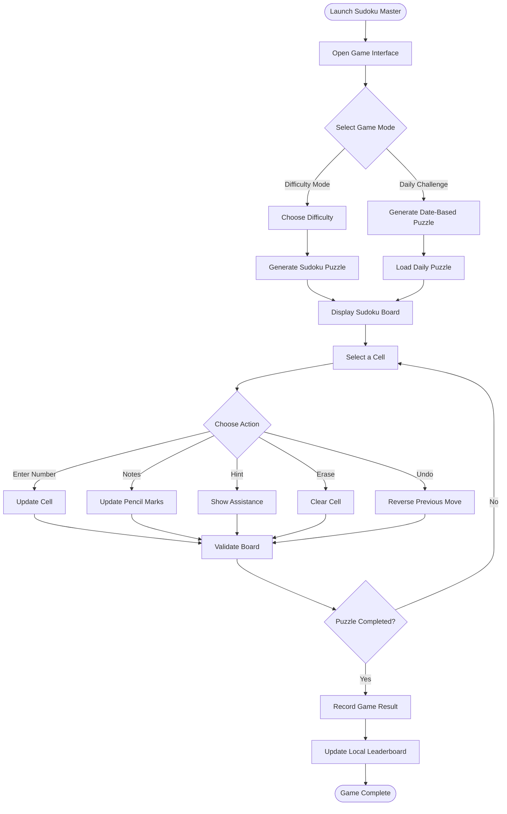
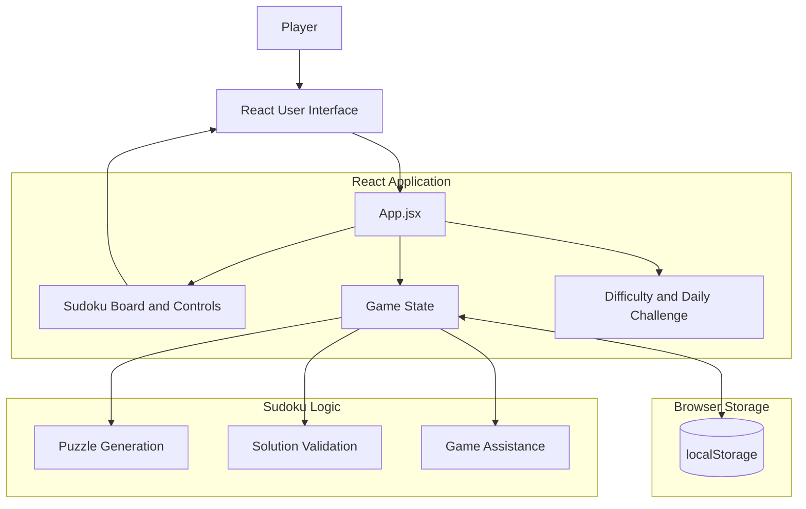
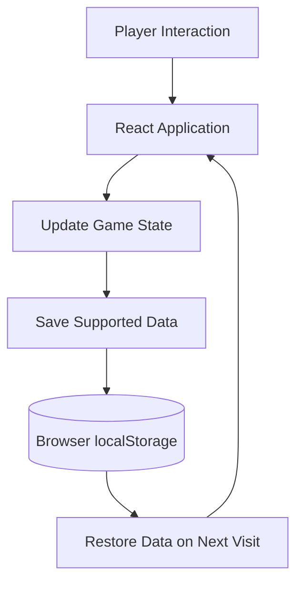

# 🧩 Sudoku Master — Interactive Sudoku Web Game

<p align="center">
  <strong>A modern, responsive Sudoku game built with React, Vite, and CSS.</strong>
  <br/>
  Challenge your logic, solve daily puzzles, track your progress, and improve your Sudoku skills.
</p>

<p align="center">
  
  
  
  
  
</p>

---

## 🌟 Project Overview

**Sudoku Master** is a browser-based Sudoku game designed to provide an engaging and interactive puzzle-solving experience.

Built from scratch using React and Vite, the application offers multiple difficulty levels, a daily challenge, keyboard navigation, pencil marks, hints, mistake tracking, and a local leaderboard.

The responsive interface supports desktop, tablet, and mobile devices, while browser `localStorage` preserves player settings and leaderboard information.

### 🎯 Project Objectives

- Build an interactive Sudoku game using React.
- Implement Sudoku puzzle generation and solution validation.
- Provide multiple difficulty levels.
- Create a daily puzzle experience.
- Improve usability with keyboard controls and pencil marks.
- Track player performance through timers and progress indicators.
- Store player preferences and leaderboard data locally.
- Deliver a responsive interface with light and dark themes.

---

## ✨ Key Features

| Feature | Description |
|---|---|
| Multiple Difficulties | Easy, Medium, Hard, and Expert |
| Daily Challenge | Date-based deterministic Sudoku puzzle |
| Puzzle Generation | Sudoku board and solution generation |
| Solution Validation | Validate entries against the puzzle solution |
| Keyboard Controls | Number keys 1–9 and arrow-key navigation |
| Erase and Undo | Correct mistakes and reverse previous actions |
| Notes Mode | Add pencil marks to empty cells |
| Hint System | Get assistance while solving |
| Error Highlighting | Identify duplicate values and incorrect entries |
| Timer | Track puzzle-solving time |
| Mistake Counter | Monitor incorrect entries |
| Progress Indicator | Track puzzle completion |
| Local Leaderboard | Store player results in the browser |
| Player Name | Save a local player identity |
| Themes | Light and dark appearance |
| Responsive Design | Desktop, tablet, and mobile layouts |
| Persistent Settings | Save preferences through `localStorage` |

---

## 🎮 Gameplay Experience

### 1. Select a Difficulty

Choose from four difficulty levels:

- Easy
- Medium
- Hard
- Expert

### 2. Solve the Puzzle

Fill the Sudoku grid using numbers from 1 to 9 while following standard Sudoku rules:

- Each row must contain numbers 1–9 without repetition.
- Each column must contain numbers 1–9 without repetition.
- Each 3×3 box must contain numbers 1–9 without repetition.

### 3. Use Game Assistance

The application provides additional tools:

- **Notes Mode:** Add pencil marks to remember possible values.
- **Hint:** Get help with a puzzle.
- **Erase:** Remove an entered value.
- **Undo:** Reverse a previous action.
- **Error Highlighting:** Identify conflicting or incorrect entries.

### 4. Track Your Performance

During gameplay, monitor:

- Elapsed time.
- Number of mistakes.
- Puzzle completion progress.

### 5. Play the Daily Challenge

The daily puzzle is generated deterministically using the current local date. Players using the same app on the same date receive the same daily puzzle.

---

## 🔄 Game Workflow



---

## 🏗️ Application Architecture

Sudoku Master is a client-side React application. Sudoku logic, user interaction, and browser persistence are handled within the frontend.



### Architecture components

| Component | Responsibility |
|---|---|
| `App.jsx` | Main application interface and game coordination |
| `sudoku.js` | Sudoku generation and validation logic |
| `styles.css` | Application styling and responsive layout |
| `main.jsx` | React application entry point |
| `localStorage` | Local persistence for supported settings and leaderboard data |
| Vite | Development server and production build tooling |

---

## 🧠 Sudoku Logic

The application includes Sudoku puzzle generation and solution validation.

### Sudoku board

A standard Sudoku puzzle uses a 9×9 grid divided into nine 3×3 sections.

```text
+-------+-------+-------+
| 5 3 . | . 7 . | . . . |
| 6 . . | 1 9 5 | . . . |
| . 9 8 | . . . | . 6 . |
+-------+-------+-------+
| 8 . . | . 6 . | . . 3 |
| 4 . . | 8 . 3 | . . 1 |
| 7 . . | . 2 . | . . 6 |
+-------+-------+-------+
| . 6 . | . . . | 2 8 . |
| . . . | 4 1 9 | . . 5 |
| . . . | . 8 . | . 7 9 |
+-------+-------+-------+
```

*Illustrative Sudoku grid.*

### Validation rules

A valid completed Sudoku board must satisfy three conditions:

1. Every row contains each digit from 1 to 9 exactly once.
2. Every column contains each digit from 1 to 9 exactly once.
3. Every 3×3 subgrid contains each digit from 1 to 9 exactly once.

The game also highlights duplicate values and incorrect entries during play.

---

## 🗓️ Daily Challenge

Sudoku Master includes a daily challenge based on the current local date.

### How it works

- The current local date is used as the daily puzzle identifier.
- Puzzle generation is deterministic for that date.
- Players using the same application on the same date receive the same puzzle.
- A new date produces a different daily challenge.

**Important:** The daily challenge is generated locally. It is not a server-controlled competition or globally synchronized event.

---

## 🏆 Leaderboard and Local Persistence

The game uses browser `localStorage` to preserve supported player data.

### Stored information

- Player name.
- Leaderboard information.
- Game settings.
- Other supported local preferences.

### Storage architecture



### Current limitations

The leaderboard and settings are stored locally in the current browser.

This means:

- Data is not shared between different users.
- Data is not automatically synchronized between devices.
- Clearing browser storage may remove saved information.
- The leaderboard is not a global competitive ranking.

A backend and database would be required for shared accounts, cross-device synchronization, and a global leaderboard.

---

## ⌨️ Keyboard Controls

| Key / Action | Function |
|---|---|
| `1`–`9` | Enter a number |
| Arrow Keys | Navigate between cells |
| Erase | Remove an entered value |
| Undo | Reverse a previous action |
| Notes Mode | Toggle pencil-mark entry |

The game also supports interaction through its visual controls.

---

## 📁 Project Structure

```text
sudoku-master/
│
├── index.html
├── package.json
├── vite.config.js
├── README.md
│
└── src/
    ├── main.jsx
    ├── App.jsx
    ├── sudoku.js
    └── styles.css
```

### File descriptions

| File | Description |
|---|---|
| `index.html` | Main HTML document |
| `package.json` | Project metadata, dependencies, and scripts |
| `vite.config.js` | Vite configuration |
| `src/main.jsx` | React application entry point |
| `src/App.jsx` | Main game interface and application logic |
| `src/sudoku.js` | Sudoku generation and validation functionality |
| `src/styles.css` | Layout, themes, and responsive styling |

---

## 🛠️ Technology Stack

| Technology | Purpose |
|---|---|
| React 18 | Component-based UI development |
| Vite 6 | Development server and build tooling |
| JavaScript ES Modules | Application logic |
| CSS3 | Styling and responsive layouts |
| HTML5 | Application structure |
| Browser localStorage | Local data persistence |
| npm | Package and dependency management |
| Node.js | JavaScript runtime and development environment |

---

## 🚀 Getting Started

### Prerequisites

Install the following:

- Node.js 18 or newer
- npm
- Git
- VS Code or another code editor

Check your installed versions:

```bash
node --version
npm --version
```

### 1. Clone the repository

```bash
git clone <YOUR_GITHUB_REPOSITORY_URL>
```

### 2. Open the project directory

```bash
cd sudoku-master
```

### 3. Install dependencies

```bash
npm install
```

### 4. Start the development server

```bash
npm run dev
```

### 5. Open the application

Vite will display a local development URL in the terminal.

Usually:

```text
http://localhost:5173
```

Open the URL in your browser to start playing.

---

## 📦 Production Build

To generate an optimized production build:

```bash
npm run build
```

The production files are generated inside:

```text
dist/
```

To preview the production build locally:

```bash
npm run preview
```

---

## ☁️ Deployment

Sudoku Master is a static frontend application and does not require a backend service or environment variables.

### Deploy on Render

1. Push the project to a GitHub repository.
2. Open the Render dashboard.
3. Select **New + → Static Site**.
4. Connect your GitHub repository.
5. Configure the following settings:

| Setting | Value |
|---|---|
| Service Type | Static Site |
| Build Command | `npm install && npm run build` |
| Publish Directory | `dist` |
| Environment Variables | Not required |

6. Click **Create Static Site**.
7. Wait for the deployment to complete.
8. Open the generated website URL.

### Deploy on Vercel

| Setting | Value |
|---|---|
| Framework | Vite |
| Build Command | `npm run build` |
| Output Directory | `dist` |

Connect the GitHub repository and deploy.

### Deploy on Netlify

| Setting | Value |
|---|---|
| Build Command | `npm run build` |
| Publish Directory | `dist` |

Connect the repository and start the deployment.

---

## 📱 Responsive Design

Sudoku Master is designed to support different screen sizes.

| Device | Experience |
|---|---|
| Desktop | Full game interface and keyboard navigation |
| Tablet | Responsive board and controls |
| Mobile | Compact layout with touch-friendly interaction |

The application also includes light and dark themes to support different visual preferences.

---

## ⚠️ Current Limitations

- Leaderboard data is stored locally rather than on a central server.
- Player information is not synchronized across devices.
- The daily challenge is generated locally rather than managed by a central service.
- No account system or online multiplayer functionality is included.
- No backend service or database is required by the current implementation.

---

## 🔮 Future Enhancements

Possible future improvements include:

- Global leaderboard with user accounts.
- Cloud-based game progress synchronization.
- Multiplayer Sudoku challenges.
- Daily and weekly tournament modes.
- More detailed performance statistics.
- Difficulty-specific completion rankings.
- Sudoku solver and step-by-step explanations.
- Achievement and badge system.
- Sound effects and additional visual themes.
- Progressive Web App (PWA) support.
- Accessibility improvements and additional keyboard shortcuts.

---

## 👨‍💻 Developer

**Developed by Lakshya Kansal**

A browser-based Sudoku game built to combine logical problem-solving, interactive gameplay, and modern frontend development.

<p align="center">
  <strong>🧩 Think Smart. Solve Fast. Master Sudoku.</strong>
</p>
